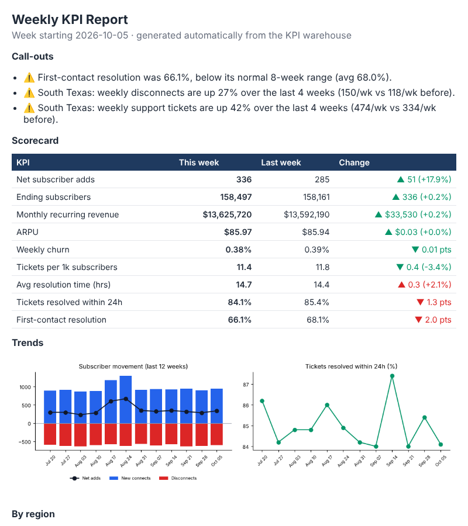

# Automated Weekly KPI Reporting Pipeline


Replaces a manual "pull three exports, paste into Excel, email leadership" routine with one scheduled command.
The pipeline extracts data from three source systems, cleans and validates it, loads a star-schema warehouse,
calculates KPIs in SQL views, and produces an Excel workbook and an email-ready HTML summary. It also writes
**automatic call-outs** that flag anything unusual, so the report says what changed instead of only showing numbers.

> **Data note:** all source data is synthetic, generated by `pipeline/generate_sources.py` for a fictional
> subscription internet provider (150k subscribers, 5 regions, 28 weeks).



## How it works

```
 Order system (monthly CSVs) ─┐
 Ticketing system (CSV)  ─────┼─► Extract ─► Transform ─► Validate ─► Load ─► SQL views ─► Excel + HTML report
 Region reference (JSON) ─────┘              (clean,       (quality    (SQLite     (KPIs,       (scorecard, trends,
                                              standardise)  gates)      warehouse)  window fns)  call-outs)
```

| Stage | What happens |
|---|---|
| **Extract** | Reads every monthly order file, the ticket export, and region reference data |
| **Transform** | Removes test orders, de-duplicates, parses US-format timestamps, assigns Monday-start weeks, derives SLA flags, builds a date dimension |
| **Validate** | Stops the run if IDs aren't unique, region codes are unknown, order types are unexpected, or any day has no orders (a sign of a missing file) |
| **Load** | Idempotent load into `dim_region`, `dim_date`, `fact_orders`, `fact_tickets`; every run is logged to an `etl_runs` audit table |
| **Model** | `sql/02_views.sql` computes weekly KPIs with CTEs and window functions (`SUM() OVER` for the running subscriber base, `LAG()` for churn) |
| **Report** | Scorecard with week-over-week change, native Excel charts, region breakdown, and call-outs for KPIs outside 2 standard deviations of their trailing 8 weeks |

## KPIs tracked
Net subscriber adds · ending subscribers · monthly recurring revenue · ARPU · weekly churn % · tickets per 1k subscribers ·
average resolution time · % of tickets resolved within 24h · first-contact resolution

Exact formulas for every KPI and call-out are in [`docs/kpi_definitions.md`](docs/kpi_definitions.md).

## Example call-outs (week of 2026-10-05)

- ⚠️ First-contact resolution was 66.1%, below its normal 8-week range (avg 68.0%).
- ⚠️ South Texas: weekly disconnects are up 27% over the last 4 weeks (150/wk vs 118/wk before).
- ⚠️ South Texas: weekly support tickets are up 42% over the last 4 weeks (474/wk vs 334/wk before).

The South Texas pattern was built into the synthetic data; the pipeline finds it without being told where to look.

## Outputs

- `output/weekly_kpi_report_<week>.xlsx` – Scorecard (conditional colouring + call-outs), Trends (data + native Excel charts), Regions, Data Quality (ETL run log + row counts)
- `output/weekly_kpi_email_<week>.html` – self-contained email body with embedded charts
- `output/bi_extracts/*.csv` – the three KPI views as CSVs, ready to load into Power BI or Tableau
- `warehouse/kpi_warehouse.db` – can be connected to Power BI / Tableau (via SQLite ODBC) to build dashboards on the same views

## Scheduling

- **GitHub Actions:** `.github/workflows/weekly-report.yml` runs the tests and the pipeline every Monday and saves the reports as a downloadable artifact.
- **cron:** `0 7 * * 1 cd /path/to/repo && python run_pipeline.py`
- **Windows Task Scheduler:** run `python run_pipeline.py` weekly with the repo folder as the start-in directory.

## Tests

`pytest` runs 9 checks, including: test orders excluded, re-runs are idempotent, region totals add up to company totals,
net adds reconcile to the subscriber base, bad region codes stop the load, and the South Texas issue is detected.

## How to run

```bash
python -m venv .venv && source .venv/bin/activate   # Windows: .venv\Scripts\activate
pip install -r requirements.txt
python run_pipeline.py                  # latest week
python run_pipeline.py --week 2026-09-14
python run_pipeline.py --regenerate     # rebuild the synthetic source data first
pytest
```

## Project structure

```
weekly-kpi-reporting-pipeline/
├── pipeline/
│   ├── generate_sources.py   # synthetic source systems
│   ├── etl.py                # extract, transform, validate, load
│   └── report.py             # Excel + HTML report, call-outs
├── sql/
│   ├── 01_schema.sql         # star schema
│   └── 02_views.sql          # KPI views
├── data/source/              # raw extracts
├── output/                   # generated reports
├── tests/test_pipeline.py
├── .github/workflows/weekly-report.yml
└── run_pipeline.py
```

## Tools
Python · Pandas · SQL (SQLite, PostgreSQL-compatible) · openpyxl · Matplotlib · pytest · GitHub Actions
